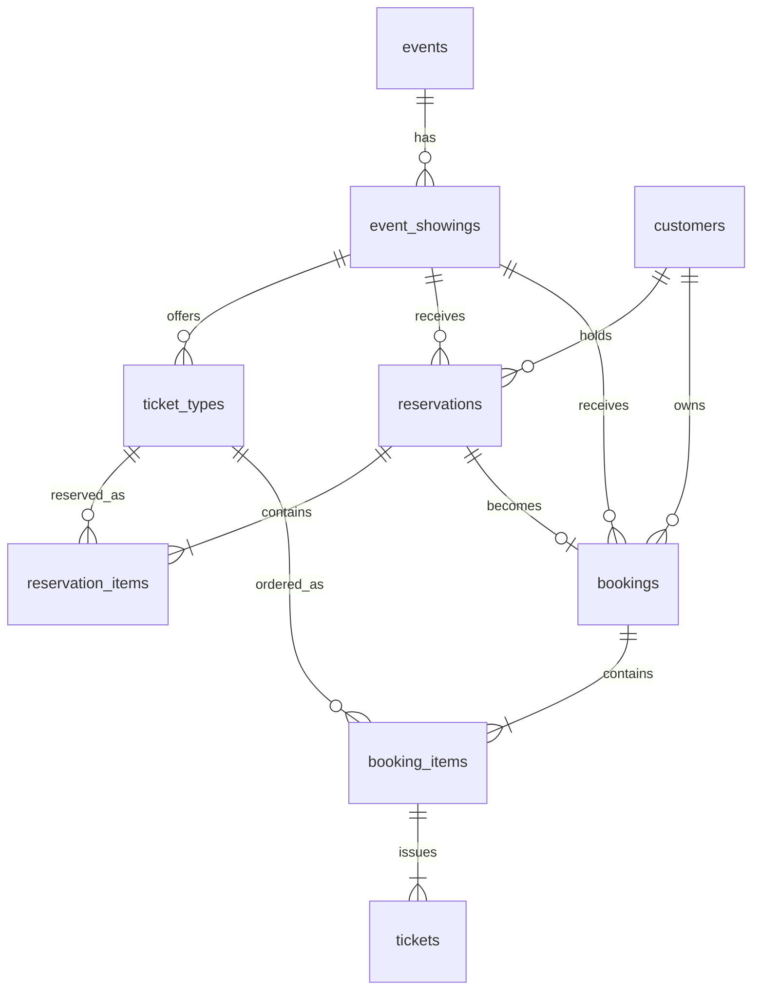

# Đặc tả dữ liệu

Mã tài liệu: ETS-DATA | Phiên bản: 1.0 | Ngày: 2026-09-21

## 1. Nguyên tắc quản lý dữ liệu

MySQL lưu bản ghi nghiệp vụ có thẩm quyền. Redis lưu bản đọc nhanh của phiếu giữ; dữ liệu Redis được phép mất và tái tạo mà không làm thay đổi quyền sở hữu vé.

Mô hình không có ghế đánh số, bảng phân bổ ghế, tài khoản đăng nhập, giao dịch thanh toán hoặc hóa đơn. Phiếu giữ và đơn là hai đối tượng riêng: phiếu có thể hết hạn mà chưa sinh đơn; đơn chỉ được tạo khi xác nhận thành công.

Số lượng đã xác nhận, số lượng đang giữ, tồn khả dụng và tổng tiền được suy ra từ dữ liệu gốc. Phiên bản 1.0 không lưu các bộ đếm tương ứng độc lập ở cả MySQL và Redis.

## 2. Mô hình quan hệ



Một sự kiện nháp có thể chưa có buổi; một buổi nháp có thể chưa có loại vé. Khi công bố, áp dụng BR-05. Quan hệ một-nhiều trên phiếu và đơn thể hiện yêu cầu nghiệp vụ; số dòng tối thiểu phải được kiểm soát ở service, không chỉ bằng khóa ngoại.

## 3. Quy ước dữ liệu

- Engine MySQL: InnoDB; bộ ký tự utf8mb4.
- ID danh mục, khách, đơn và vé: INT UNSIGNED, tự sinh; seed lab có thể chỉ định ID.
- Phiếu giữ và request_key: UUID dạng chuỗi CHAR(36). request_key duy nhất trong phạm vi customer_id.
- Mã nghiệp vụ: chuỗi ASCII uppercase gồm chữ, số, dấu gạch nối hoặc gạch dưới; so sánh chính xác sau chuẩn hóa.
- Tên: Unicode, trim, không rỗng. Tìm tên không phân biệt hoa/thường và dấu; cấu hình collation/validator phải có kiểm thử tương ứng.
- Giá: INT UNSIGNED, giới hạn 0..1000000000; không làm tròn số thập phân từ input.
- Timestamps: DATETIME(3), lưu UTC. API nhận ISO 8601 có Z/offset và trả UTC; driver/session phải xử lý nhất quán.
- Trừ các cột ghi rõ NULL, cột đều bắt buộc. Khóa cha và khóa con phải cùng kiểu và signedness.
- Tổng tiền tính bằng kiểu số đủ lớn, không ép SUM hoặc quantity x price về INT; tổng 6 vé có thể vượt INT UNSIGNED.

### 3.1. customers

| Cột | Kiểu | Quy định |
| --- | --- | --- |
| id | INT UNSIGNED | PK |
| full_name | VARCHAR(100) | Tên khách mẫu, không trắng |
| email | VARCHAR(254) | Email liên hệ mẫu; không phải khóa đăng nhập |
| created_at | DATETIME(3) | UTC |

Dữ liệu khách được seed cho trình diễn. Không lưu password hoặc role ở bảng này. Mẫu email dùng miền example.com; không yêu cầu duy nhất email khi chưa có nghiệp vụ tài khoản.

### 3.2. events

| Cột | Kiểu | Quy định |
| --- | --- | --- |
| id | INT UNSIGNED | PK |
| event_code | VARCHAR(30) | UNIQUE; 3-30 ký tự; bất biến |
| name | VARCHAR(150) | Không trắng |
| description | VARCHAR(2000) NULL | Văn bản thuần |
| category_code | VARCHAR(20) | MUSIC, THEATER, WORKSHOP, SPORT hoặc OTHER |
| status | VARCHAR(12) | DRAFT/PUBLISHED/CLOSED |
| created_at | DATETIME(3) | UTC |
| updated_at | DATETIME(3) | UTC |

Thể loại dùng danh mục cố định trong phiên bản 1.0, không có màn hình quản lý thể loại riêng. Địa điểm và thời gian thuộc buổi, không đặt thêm ở events.

### 3.3. event_showings

| Cột | Kiểu | Quy định |
| --- | --- | --- |
| id | INT UNSIGNED | PK |
| event_id | INT UNSIGNED | FK events; bất biến |
| showing_code | VARCHAR(30) | 1-30 ký tự; UNIQUE(event_id, showing_code); bất biến |
| city_code | VARCHAR(20) | 2-20 ký tự, mã địa phương; seed dùng HCM/HN |
| venue_name | VARCHAR(200) | Tên địa điểm, không trắng |
| starts_at | DATETIME(3) | Giờ bắt đầu buổi |
| ends_at | DATETIME(3) | Sau starts_at |
| sales_starts_at | DATETIME(3) | Giờ bắt đầu bán |
| sales_ends_at | DATETIME(3) | Sau sales_starts_at, không sau starts_at |
| created_at | DATETIME(3) | UTC |
| updated_at | DATETIME(3) | UTC |

Một buổi có một cửa sổ bán áp dụng cho toàn bộ loại vé. Không bổ sung lịch bán riêng từng loại trong phiên bản 1.0. Mã buổi giống nhau ở hai sự kiện khác nhau là hợp lệ.

### 3.4. ticket_types

| Cột | Kiểu | Quy định |
| --- | --- | --- |
| id | INT UNSIGNED | PK |
| showing_id | INT UNSIGNED | FK event_showings; bất biến |
| ticket_code | VARCHAR(20) | 1-20 ký tự; UNIQUE(showing_id, ticket_code); bất biến |
| name | VARCHAR(100) | Tên hiển thị, ví dụ VIP/Standard |
| price_vnd | INT UNSIGNED | 0..1000000000 |
| capacity | INT UNSIGNED | 1..100000 |
| created_at | DATETIME(3) | UTC |
| updated_at | DATETIME(3) | UTC |

capacity là số phát hành riêng của loại vé trong một buổi. Không lưu remaining, sold hoặc held thành các cột độc lập. Việc thay đổi capacity/price chỉ được thực hiện khi sự kiện DRAFT.

### 3.5. reservations

| Cột | Kiểu | Quy định |
| --- | --- | --- |
| id | CHAR(36) | PK, UUID của phiếu giữ |
| customer_id | INT UNSIGNED | FK customers |
| showing_id | INT UNSIGNED | FK event_showings |
| request_key | CHAR(36) | Mã yêu cầu chống lặp; UNIQUE(customer_id, request_key) |
| status | VARCHAR(12) | ACTIVE/CONSUMED/RELEASED/EXPIRED |
| created_at | DATETIME(3) | Thời điểm cấp |
| expires_at | DATETIME(3) | Sau created_at, không đổi |
| finished_at | DATETIME(3) NULL | NULL khi ACTIVE; thời điểm kết thúc khi trạng thái khác |
| updated_at | DATETIME(3) | Cập nhật khi chuyển trạng thái |

So sánh request gửi lại bằng showing_id và danh sách ticket_type_id/quantity đã chuẩn hóa theo thứ tự ID. Không so sánh theo thứ tự mảng, số lượng key JSON hoặc dữ liệu giá do client cung cấp. Cùng request_key nhưng khác nội dung bị từ chối.

Một dòng ACTIVE có expires_at <= now được diễn giải EXPIRED trong nghiệp vụ, không còn chiếm tồn. Tác vụ nền cập nhật trạng thái vật lý và finished_at sau đó. finished_at của EXPIRED ghi thời điểm hết hạn; updated_at ghi thời điểm xử lý thực tế.

Điều kiện một khách chỉ có một phiếu còn hiệu lực mỗi buổi là ràng buộc nghiệp vụ có yếu tố thời gian, không thể thay bằng UNIQUE(customer_id, showing_id) trên toàn bộ lịch sử.

### 3.6. reservation_items

| Cột | Kiểu | Quy định |
| --- | --- | --- |
| reservation_id | CHAR(36) | Thành phần PK |
| ticket_type_id | INT UNSIGNED | Thành phần PK |
| showing_id | INT UNSIGNED | Cùng buổi với phiếu và loại vé |
| quantity | INT UNSIGNED | 1..6; tổng số lượng phiếu <= 6 |
| unit_price_vnd | INT UNSIGNED | Giá tại thời điểm giữ, 0..1000000000 |

PK(reservation_id, ticket_type_id). Chi tiết phiếu giữ bất biến. Thay đổi lựa chọn tạo phiếu mới sau khi giải phóng phiếu cũ.

### 3.7. bookings

| Cột | Kiểu | Quy định |
| --- | --- | --- |
| id | INT UNSIGNED | PK |
| booking_code | VARCHAR(32) | Mã tra cứu UNIQUE, không dùng làm chứng thực quyền sở hữu |
| reservation_id | CHAR(36) | UNIQUE; một phiếu sinh tối đa một đơn |
| customer_id | INT UNSIGNED | Cùng khách với phiếu |
| showing_id | INT UNSIGNED | Cùng buổi với phiếu |
| status | VARCHAR(12) | CONFIRMED/CANCELLED |
| booked_at | DATETIME(3) | Thời điểm xác nhận |
| cancelled_at | DATETIME(3) NULL | NULL nếu CONFIRMED; >= booked_at nếu CANCELLED |

Không có PENDING hoặc PAID. Việc giữ vé chưa phải một đơn. Hủy đơn không đổi trạng thái CONSUMED của phiếu nguồn.

### 3.8. booking_items

| Cột | Kiểu | Quy định |
| --- | --- | --- |
| booking_id | INT UNSIGNED | Thành phần PK |
| ticket_type_id | INT UNSIGNED | Thành phần PK |
| showing_id | INT UNSIGNED | Cùng buổi với đơn và loại vé |
| quantity | INT UNSIGNED | 1..6; khớp dòng phiếu nguồn |
| unit_price_vnd | INT UNSIGNED | Giá chốt từ phiếu nguồn, không sửa |

PK(booking_id, ticket_type_id). Không lấy giá hiện tại để tính lại đơn lịch sử. Không xóa chi tiết khi hủy.

### 3.9. tickets

| Cột | Kiểu | Quy định |
| --- | --- | --- |
| id | INT UNSIGNED | PK |
| ticket_code | VARCHAR(32) | Mã vé UNIQUE toàn hệ thống |
| booking_id | INT UNSIGNED | Thuộc dòng đơn |
| ticket_type_id | INT UNSIGNED | Thuộc dòng đơn |
| ordinal | INT UNSIGNED | Số thứ tự 1..quantity trong dòng đơn |
| issued_at | DATETIME(3) | Thời điểm phát hành UTC |

FK(booking_id, ticket_type_id) tham chiếu booking_items. UNIQUE(booking_id, ticket_type_id, ordinal) ngăn phát hành lặp cùng đơn vị vé. Service phải bảo đảm có đúng quantity mã, không thiếu hoặc thừa. Vé không có cột status riêng: hiệu lực lấy từ bookings.status. Không lưu bí mật khách hàng trong mã vé.

## 4. Ràng buộc và công thức toàn vẹn

### 4.1. Quan hệ cùng buổi

Các cột showing_id lặp trong bảng chi tiết có mục đích kiểm soát vé thuộc đúng buổi. Thiết kế vật lý phải có khóa duy nhất được tham chiếu và FK ghép:

- reservation_items(reservation_id, showing_id) -> reservations(id, showing_id).
- reservation_items(ticket_type_id, showing_id) -> ticket_types(id, showing_id).
- bookings(reservation_id, customer_id, showing_id) -> reservations(id, customer_id, showing_id).
- booking_items(booking_id, showing_id) -> bookings(id, showing_id).
- booking_items(ticket_type_id, showing_id) -> ticket_types(id, showing_id).
- tickets(booking_id, ticket_type_id) -> booking_items(booking_id, ticket_type_id).

Bổ sung UNIQUE tương ứng trên các cặp/bộ khóa cha trước khi tạo FK. FK thông thường nối reservations/bookings về customers và event_showings; ticket_types về event_showings; event_showings về events.

Chính sách xóa khóa cha là RESTRICT. Xóa danh mục nháp phải kiểm tra điều kiện rồi xóa con và cha trong transaction. Không CASCADE xóa dữ liệu lịch sử. PK/UNIQUE/FK/CHECK là lớp kiểm soát dữ liệu; không thay thế kiểm tra trạng thái, quyền sở hữu và kiểm soát đồng thời.

### 4.2. Tồn vé

Với một loại vé tại thời điểm t:

```text
confirmed = SUM(quantity của booking_items có đơn CONFIRMED)
held      = SUM(quantity của reservation_items
                có phiếu ACTIVE và expires_at > t)
available = capacity - confirmed - held

Điều kiện: confirmed >= 0, held >= 0, available >= 0
```

Các tổng phải được tính riêng trước khi kết hợp; không JOIN thẳng hai tập nhiều dòng rồi SUM gây nhân bản. Chuyển phiếu thành đơn phải loại số lượng khỏi held và thêm vào confirmed trong cùng transaction.

Khi hủy đơn, confirmed giảm do trạng thái đơn đổi; không thực hiện thêm một thao tác “tăng capacity”. Khi phiếu hết hạn, held giảm theo điều kiện thời gian; không tăng capacity và không dựa vào một bộ đếm Redis.

Kiểm tra tồn và ghi phiếu/đơn cần được tuần tự hóa đối với các loại vé liên quan. Thành viên Concurrency thiết kế cơ chế khóa/thứ tự xử lý và chứng minh bằng test; phép đọc available rồi ghi ở hai thao tác độc lập không đáp ứng yêu cầu.

### 4.3. Các điều kiện không chỉ dựa vào CHECK

- Tổng số vé mỗi phiếu/đơn 1..6.
- Một khách chỉ có một phiếu còn hiệu lực cho một buổi.
- Giá/số lượng dòng đơn khớp phiếu nguồn.
- Đủ số mã vé theo dòng đơn.
- ACTIVE chưa hết hạn tại thời điểm chấp nhận xác nhận.
- Đơn, phiếu và tồn vé nhất quán khi xử lý đồng thời.
- Đóng sự kiện và xác nhận phiếu có kết quả tương ứng một thứ tự xử lý hợp lệ.

Các điều kiện này thuộc service/transaction và phải có kiểm thử, không chỉ ghi vào mô tả bảng.

## 5. Redis trong ứng dụng

| Key | Kiểu | Nội dung | Vòng đời |
| --- | --- | --- | --- |
| app:reservation:<uuid> | Hash | customer_id, showing_id, status, expires_at, updated_at, items_json | Chỉ phiếu ACTIVE; TTL theo thời hạn còn lại |

items_json chứa ticket_type_id, quantity và unit_price_vnd; không chứa email hoặc thông tin nhạy cảm. Đây là JSON được tuần tự hóa trong một field Hash, không yêu cầu RedisJSON.

Backend ghi MySQL trước, sau đó cập nhật bản Redis. Khi đọc cache, phải đối chiếu chủ sở hữu, trạng thái hiệu lực và updated_at với bản ghi MySQL; không dùng trạng thái cache để cấp quyền hoặc xác nhận đơn. Chi tiết phiếu bất biến có thể đọc từ cache sau đối chiếu; cache thiếu/lệch thì đọc và tái tạo từ MySQL.

Phiếu kết thúc được loại khỏi cache theo cách không làm hồi sinh trạng thái cũ. Ghi Redis thất bại sau commit không làm rollback giả giao dịch MySQL: trả trạng thái đã ghi nhận, ghi lỗi và cho phép tái tạo cache. Redis gián đoạn không được làm sinh thêm phiếu, đơn hoặc tồn vé.

Tác vụ xử lý phiếu hết hạn đọc MySQL làm căn cứ. Không phụ thuộc hoàn toàn vào thông báo key hết hạn. Dữ liệu hết hạn vẫn nằm trong lịch sử MySQL.

## 6. Redis cho thực nghiệm độc lập

Prefix lab: lab:<run_id>:. Không sử dụng key ứng dụng để thử thao tác native hoặc lỗi dữ liệu.

| Key sau prefix | Kiểu | Nội dung |
| --- | --- | --- |
| events | Set | ID sự kiện |
| event:<id> | Hash | Dữ liệu sự kiện |
| event_codes | Hash | Mã sự kiện -> ID |
| event:<id>:showings | Set | ID buổi thuộc sự kiện |
| showing:<id> | Hash | Dữ liệu buổi |
| event:<id>:showing_codes | Hash | Mã buổi -> ID |
| showing:<id>:ticket_types | Set | ID loại vé thuộc buổi |
| ticket_type:<id> | Hash | Loại vé, giá, capacity |
| showing:<id>:ticket_codes | Hash | Mã loại vé -> ID |
| showings:city:<code> | Set | Index địa phương của buổi |

ID/quantity/price biểu diễn bằng chuỗi số nguyên; thời gian là ISO UTC; null được biểu diễn bằng field vắng. Chuẩn hóa kiểu và sắp theo ID trước so sánh với MySQL. Không dùng thứ tự trả về của Set làm thứ tự nghiệp vụ.

CRUD lab phải duy trì cả đối tượng và index liên quan. Kiểm tra trùng trước HSET không phải bảo đảm đồng thời; phần Storage chạy tuần tự và ghi rõ giới hạn. Các thực nghiệm Transaction/Concurrency mở rộng dữ liệu lab bằng tồn vé/đơn/phiếu phù hợp kịch bản, không gọi MySQL để thực hiện thay Redis.

## 7. Lưu trữ và truy vết

Bản ghi nghiệp vụ không có TTL. Phiếu hết hạn và đơn hủy được giữ để đối chiếu. Chưa có chính sách xóa lịch sử định kỳ trong phiên bản 1.0.

Các thí nghiệm persistence ghi phiên bản, volume và cấu hình runtime; kiểm tra nội dung trước/sau restart bình thường ở môi trường lab. Không dùng việc restart thành công làm bằng chứng an toàn khi mất điện hoặc mất máy. Volume/persistence không thay thế backup.

Nguồn kỹ thuật:

- [MySQL 8.4 - Foreign Key Constraints](https://dev.mysql.com/doc/refman/8.4/en/create-table-foreign-keys.html).
- [MySQL 8.4 - Locking Reads](https://dev.mysql.com/doc/refman/8.4/en/innodb-locking-reads.html).
- [Redis Transactions](https://redis.io/docs/latest/develop/using-commands/transactions/).
- [Redis Persistence](https://redis.io/docs/latest/operate/oss_and_stack/management/persistence/).

Tên bảng và cơ cấu dữ liệu ở đây là thiết kế của dự án. DDL, index hiệu năng và phương thức khóa phải được hiện thực, kiểm thử trước khi nghiệm thu; tài liệu này không phải migration đã chạy.
