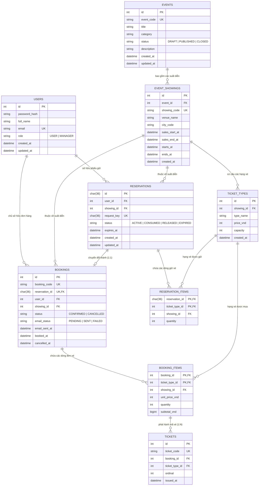

# Tài liệu Thiết kế & Mô tả Cơ sở Dữ liệu Hệ thống EventBox

| Thuộc tính | Nội dung |
| :--- | :--- |
| **Mã tài liệu** | ETS-DBD (Event Ticketing System - Database Design) |
| **Phiên bản** | 1.0 |
| **Ngày phát hành** | 2026-09-25 |
| **Môn học** | Hệ quản trị Cơ sở dữ liệu (DBMS - HK261) |
| **Hệ quản trị CSDL** | **MySQL 8.0 (InnoDB)** làm System of Record + **Redis 7.0 (In-Memory)** làm Concurrency Cache |

---

## 1. Tổng quan Kiến trúc Dữ liệu (Dual-DBMS Architecture)

Hệ thống đặt vé sự kiện **EventBox** là một Web Application phục vụ bài toán bán vé trực tuyến. Để giải quyết triệt để các thách thức về **Lưu trữ dữ liệu có cấu trúc (Storage)**, **Tính toàn vẹn giao dịch (ACID Transaction)** và **Kiểm soát đồng thời (Concurrency Control)**, kiến trúc dữ liệu được thiết kế kết hợp hai hệ quản trị CSDL:

```
[ Client: React 19 SPA ]
          │  (REST API / JSON / Bearer JWT)
          ▼
[ Backend: Node.js Express API ]
    ├── 1. Xác thực & Ghi nhận bền vững (SoR) ──▶ [ MySQL 8.0 (InnoDB) ]
    │      - ACID Transactions (F05)                  - 9 Bảng quan hệ chuẩn hóa 3NF/BCNF
    │      - Khóa ngoại & Ràng buộc toàn vẹn          - DDL Schema, DML Seeds & DQL
    │      - Lịch sử đơn hàng, vé, tài khoản RBAC     - Lưu trữ Cloud/Local, B-Tree Indexes
    │
    └── 2. Giữ vé tạm thời & Concurrency ────────▶ [ Redis 7.0 (In-Memory) ]
           - Atomic Lua Scripts (F04)                 - Hash/Set tồn vé tạm thời
           - Tránh Race Condition / Overselling       - Key TTL tự động hủy sau 300s
```

### 1.1. Vai trò của MySQL 8.0 (InnoDB) - System of Record (SoR)
- **Cơ sở dữ liệu có thẩm quyền cao nhất (Single Source of Truth):** Lưu trữ toàn bộ dữ liệu nghiệp vụ cốt lõi: tài khoản người dùng, danh mục sự kiện, suất diễn, hạng vé, đơn đặt vé, chi tiết đơn và vé điện tử phát hành.
- **Engine lưu trữ InnoDB:** Hỗ trợ đầy đủ giao dịch chuẩn **ACID**, khóa mức dòng (Row-level Locking) và kiểm soát toàn vẹn tham chiếu thông qua khóa ngoại (`FOREIGN KEY`) với chính sách `ON DELETE RESTRICT`.
- **Mã hóa ký tự:** Bảng mã `utf8mb4` kết hợp collation `utf8mb4_unicode_ci` hỗ trợ lưu trữ tiếng Việt có dấu và biểu tượng cảm xúc.
- **Múi giờ:** Chuẩn hóa toàn bộ thời gian lưu trữ theo chuẩn UTC (`DATETIME(3)`) để đảm bảo tính nhất quán trên mọi môi trường.

### 1.2. Vai trò của Redis 7.0 - Concurrency & TTL Cache
- **Cơ chế giữ vé tạm thời (Reservation Hold - F04):** Trong các sự kiện "hot", hàng nghìn người dùng có thể cùng lúc chọn vé. Redis thực thi các kịch bản **Lua Script đơn luồng nguyên tử (Atomic)** để kiểm tra và trừ tồn khả dụng trong bộ nhớ RAM cực nhanh mà không gây quá tải cho MySQL.
- **Hết hạn tự động (Time-To-Live - TTL):** Phiếu giữ vé tạm thời được gán thời gian sống chính xác là **300 giây (5 phút)**. Khi quá hạn, vé tự động được giải phóng cho khách hàng khác mà không làm sai lệch dữ liệu tài chính trong MySQL.
- **Tính độc lập:** Redis hoạt động như tầng đệm gia tốc. Dữ liệu Redis được phép mất hoặc khởi động lại mà không làm ảnh hưởng đến dữ liệu vé đã chốt đơn trong MySQL.

---

## 2. Mô hình Thực thể - Quan hệ Mở rộng (Conceptual Data Model & ERD)

### 2.1. Danh mục Thực thể Logic (Entities)

1. **User (Người dùng):** Đại diện cho chủ tài khoản hệ thống. Phân quyền thành hai vai trò độc lập:
   - `USER`: Khách hàng cá nhân, người thực hiện tìm kiếm, giữ vé, chốt đơn và nhận email vé điện tử.
   - `MANAGER`: Người quản trị hệ thống, quản lý sự kiện, cấu hình suất diễn và theo dõi báo cáo doanh thu.
2. **Event (Sự kiện):** Thực thể danh mục thông tin sự kiện (tên, thể loại, mô tả, trạng thái vòng đời `DRAFT`, `PUBLISHED`, `CLOSED`).
3. **EventShowing (Buổi tổ chức / Suất diễn):** Thực thể biểu diễn thời gian và địa điểm cụ thể của một sự kiện. Một sự kiện có thể có một hoặc nhiều suất diễn.
4. **TicketType (Hạng vé):** Thực thể định nghĩa phân hạng vé (Standard, VIP, Early Bird...) trực thuộc một suất diễn, bao gồm đơn giá và tổng số vé phát hành (sức chứa).
5. **Reservation (Phiếu giữ vé tạm thời):** Bản ghi đánh dấu việc khách hàng tạm giữ một số lượng vé trong 300 giây. Có trạng thái `ACTIVE`, `CONSUMED`, `RELEASED`, `EXPIRED`.
6. **ReservationItem (Chi tiết phiếu giữ vé):** Thực thể kết hợp biểu diễn số lượng vé của từng hạng vé mà khách hàng đang giữ trong một phiếu.
7. **Booking (Đơn đặt vé chính thức):** Bản ghi xác nhận mua vé hợp lệ thông qua giao dịch ACID nội bộ trong CSDL. Trạng thái `CONFIRMED`, `CANCELLED`.
8. **BookingItem (Chi tiết đơn vé):** Dòng chi tiết chốt số lượng vé, đơn giá thực tế tại thời điểm mua và thành tiền.
9. **Ticket (Vé điện tử phát hành):** Thực thể cấp đơn vị vé cụ thể (Unit-level Ticket) mang mã định danh duy nhất (`ticket_code`), phục vụ việc xuất trình và gửi email thông báo vé.

### 2.2. Biểu đồ Thực thể - Quan hệ (Mermaid ERD)



---

## 3. Lược đồ Cơ sở Dữ liệu Quan hệ Logic (Logical Relational Schema)

Biểu diễn lược đồ quan hệ theo ký hiệu toán học hình thức: tên quan hệ theo sau bởi danh sách thuộc tính trong dấu ngoặc đơn; **khóa chính (Primary Key)** được gạch dưới, thuộc tính mang nhãn *[FK]* là khóa ngoại:

1. $\text{users}(\underline{\text{id}}, \text{username}, \text{password\_hash}, \text{full\_name}, \text{email}, \text{role}, \text{created\_at}, \text{updated\_at})$
2. $\text{events}(\underline{\text{id}}, \text{event\_code}, \text{title}, \text{category}, \text{status}, \text{description}, \text{created\_at}, \text{updated\_at})$
3. $\text{event\_showings}(\underline{\text{id}}, \text{event\_id}\text{ [FK]}, \text{showing\_code}, \text{venue\_name}, \text{city\_code}, \text{sales\_start\_at}, \text{sales\_end\_at}, \text{starts\_at}, \text{ends\_at}, \text{created\_at})$
4. $\text{ticket\_types}(\underline{\text{id}}, \text{showing\_id}\text{ [FK]}, \text{type\_name}, \text{price\_vnd}, \text{capacity}, \text{created\_at})$
5. $\text{reservations}(\underline{\text{id}}, \text{user\_id}\text{ [FK]}, \text{showing\_id}\text{ [FK]}, \text{request\_key}, \text{status}, \text{expires\_at}, \text{created\_at}, \text{updated\_at})$
6. $\text{reservation\_items}(\underline{\text{reservation\_id}\text{ [FK]}, \text{ticket\_type\_id}\text{ [FK]}}, \text{showing\_id}\text{ [FK]}, \text{quantity})$
7. $\text{bookings}(\underline{\text{id}}, \text{booking\_code}, \text{reservation\_id}\text{ [FK]}, \text{user\_id}\text{ [FK]}, \text{showing\_id}\text{ [FK]}, \text{status}, \text{email\_status}, \text{email\_sent\_at}, \text{booked\_at}, \text{cancelled\_at})$
8. $\text{booking\_items}(\underline{\text{booking\_id}\text{ [FK]}, \text{ticket\_type\_id}\text{ [FK]}}, \text{showing\_id}\text{ [FK]}, \text{unit\_price\_vnd}, \text{quantity}, \text{subtotal\_vnd})$
9. $\text{tickets}(\underline{\text{id}}, \text{ticket\_code}, \text{booking\_id}\text{ [FK]}, \text{ticket\_type\_id}\text{ [FK]}, \text{ordinal}, \text{issued\_at})$

---

## 4. Phân tích Chuẩn hóa Cơ sở Dữ liệu (Database Normalization Analysis)

Một trong những tiêu chí học thuật quan trọng của đồ án DBMS là chứng minh lược đồ đạt các chuẩn thiết kế CSDL, triệt tiêu tối đa trùng lặp dữ liệu và loại trừ các dị thường bất thường (Anomalies).

### 4.1. Khảo sát Phụ thuộc Hàm (Functional Dependencies - FDs)

- **Quan hệ `users`:**
  - $F_1: \text{id} \to \{\text{username}, \text{password\_hash}, \text{full\_name}, \text{email}, \text{role}, \text{created\_at}, \text{updated\_at}\}$
  - $F_2: \text{username} \to \{\text{id}, \text{password\_hash}, \text{full\_name}, \text{email}, \text{role}, \text{created\_at}, \text{updated\_at}\}$
  - $F_3: \text{email} \to \{\text{id}, \text{username}, \text{password\_hash}, \text{full\_name}, \text{role}, \text{created\_at}, \text{updated\_at}\}$
  - **Khóa ứng viên:** $\{\text{id}\}$, $\{\text{username}\}$, $\{\text{email}\}$.

- **Quan hệ `events`:**
  - $F_4: \text{id} \to \{\text{event\_code}, \text{title}, \text{category}, \text{status}, \text{description}, \text{created\_at}, \text{updated\_at}\}$
  - $F_5: \text{event\_code} \to \{\text{id}, \text{title}, \text{category}, \text{status}, \text{description}, \text{created\_at}, \text{updated\_at}\}$
  - **Khóa ứng viên:** $\{\text{id}\}$, $\{\text{event\_code}\}$.

- **Quan hệ `event_showings`:**
  - $F_6: \text{id} \to \{\text{event\_id}, \text{showing\_code}, \text{venue\_name}, \text{city\_code}, \text{sales\_start\_at}, \text{sales\_end\_at}, \text{starts\_at}, \text{ends\_at}, \text{created\_at}\}$
  - $F_7: \text{showing\_code} \to \{\text{id}, \text{event\_id}, \dots\}$
  - **Khóa ứng viên:** $\{\text{id}\}$, $\{\text{showing\_code}\}$.

- **Quan hệ `ticket_types`:**
  - $F_8: \text{id} \to \{\text{showing\_id}, \text{type\_name}, \text{price\_vnd}, \text{capacity}, \text{created\_at}\}$
  - $F_9: \{\text{showing\_id}, \text{type\_name}\} \to \{\text{id}, \text{price\_vnd}, \text{capacity}, \text{created\_at}\}$
  - **Khóa ứng viên:** $\{\text{id}\}$, $\{\text{showing\_id}, \text{type\_name}\}$.

- **Quan hệ `booking_items`:**
  - $F_{10}: \{\text{booking\_id}, \text{ticket\_type\_id}\} \to \{\text{showing\_id}, \text{unit\_price\_vnd}, \text{quantity}, \text{subtotal\_vnd}\}$
  - Không có thuộc tính ngoài khóa nào xác định phụ thuộc một phần lên khóa chính phức hợp.

- **Quan hệ `tickets`:**
  - $F_{11}: \text{id} \to \{\text{ticket\_code}, \text{booking\_id}, \text{ticket\_type\_id}, \text{ordinal}, \text{issued\_at}\}$
  - $F_{12}: \text{ticket\_code} \to \{\text{id}, \text{booking\_id}, \text{ticket\_type\_id}, \text{ordinal}, \text{issued\_at}\}$
  - $F_{13}: \{\text{booking\_id}, \text{ticket\_type\_id}, \text{ordinal}\} \to \{\text{id}, \text{ticket\_code}, \text{issued\_at}\}$
  - **Khóa ứng viên:** $\{\text{id}\}$, $\{\text{ticket\_code}\}$, $\{\text{booking\_id}, \text{ticket\_type\_id}, \text{ordinal}\}$.

### 4.2. Chứng minh Đạt Chuẩn 1NF, 2NF, 3NF và BCNF

1. **Chuẩn 1 (1NF - First Normal Form):**
   - Mọi thuộc tính trong tất cả các bảng đều mang giá trị nguyên tử (Atomic values), không chứa tập giá trị (Multivalued attributes) hay thuộc tính phức hợp (Composite attributes). Ví dụ: `venue_name`, `city_code` được tách biệt, danh sách vé không lưu dạng mảng chuỗi trong `bookings` mà tách thành quan hệ riêng `tickets`.
2. **Chuẩn 2 (2NF - Second Normal Form):**
   - Đạt 1NF và mọi thuộc tính không khóa đều **phụ thuộc hàm đầy đủ (Full functional dependency)** vào toàn bộ khóa chính, không có sự phụ thuộc từng phần vào khóa phức hợp.
   - Đối với các bảng có khóa chính phức hợp:
     - `reservation_items`: Khóa chính là `(reservation_id, ticket_type_id)`. Thuộc tính `quantity` phụ thuộc vào cả cặp khóa này. Cột `showing_id` được duy trì có chủ đích để kiểm soát toàn vẹn khóa ngoại phân cấp.
     - `booking_items`: Khóa chính là `(booking_id, ticket_type_id)`. Cả `unit_price_vnd`, `quantity`, `subtotal_vnd` đều phụ thuộc vào toàn bộ cặp khóa.
3. **Chuẩn 3 (3NF - Third Normal Form):**
   - Đạt 2NF và **không tồn tại phụ thuộc bắc cầu (Transitive dependency)** giữa các thuộc tính không khóa ($X \to Y \to Z$ với $Y$ không phải là siêu khóa).
   - Ví dụ: `bookings` không lưu `event_id` hay `title` (vì thông tin này xác định qua `showing_id`); `ticket_types` không lưu tên sự kiện hay địa chỉ tổ chức.
4. **Chuẩn Boyce-Codd (BCNF - Boyce-Codd Normal Form):**
   - Với mọi phụ thuộc hàm không tầm thường $X \to Y$, vế trái $X$ đều là một **siêu khóa (Superkey)**.
   - Trong toàn bộ các bảng của hệ thống, mọi thuộc tính quyết định (LHS của FDs) đều là khóa chính (PK) hoặc khóa duy nhất (Candidate Key / UNIQUE). Không có trường hợp thuộc tính khóa phụ thuộc vào thuộc tính không khóa. Do đó, lược đồ đạt **BCNF**.

### 4.3. Loại trừ Triệt để Dị thường Dữ liệu (Anomalies Elimination)
- **Dị thường thêm (Insertion Anomaly):** Quản lý có thể tạo một sự kiện mới (`DRAFT`) mà không bắt buộc phải tạo ngay suất diễn hoặc loại vé; có thể đăng ký tài khoản khách hàng mới mà không cần phát sinh đơn hàng.
- **Dị thường xóa (Deletion Anomaly):** Xóa một suất diễn chưa phát hành vé không làm mất thông tin của sự kiện cha; hủy một đơn hàng không làm mất thông tin của người dùng hay cấu cấu giá của loại vé.
- **Dị thường cập nhật (Update Anomaly):** Không lưu trữ dư thừa các giá trị tổng hợp động như "số vé còn lại" hay "tổng doanh thu" vào các bảng danh mục; các giá trị này được tính toán động (Dynamic Aggregation) qua SQL DQL hoặc Redis Cache, triệt tiêu hoàn toàn nguy cơ lệch số liệu khi có thao tác sửa/hủy.

---

## 5. Từ điển Dữ liệu Chi tiết (Data Dictionary - 9 Bảng)

### 5.1. Bảng `users` (Tài khoản người dùng & Phân quyền)
Lưu trữ thông tin xác thực và phân quyền RBAC. Đăng nhập thực hiện qua biểu mẫu chuẩn, **tuyệt đối không hỗ trợ Quick Demo / 1-Click bypass**.

| Tên cột | Kiểu dữ liệu | Nullable | Mặc định | Khóa / Ràng buộc | Mô tả nghiệp vụ |
| :--- | :--- | :---: | :---: | :--- | :--- |
| `id` | `INT UNSIGNED` | No | Auto Inc | **PK** | Định danh nội bộ của tài khoản người dùng |
| `username` | `VARCHAR(50)` | No | | **UNIQUE** | Tên đăng nhập (chữ, số, gạch dưới; 3-50 ký tự) |
| `password_hash` | `VARCHAR(255)` | No | | | Chuỗi băm mật khẩu bảo mật bằng Bcrypt (10 rounds) |
| `full_name` | `VARCHAR(100)` | No | | | Họ và tên đầy đủ của người dùng |
| `email` | `VARCHAR(254)` | No | | **UNIQUE** | Email hợp lệ nhận thông báo và mã vé điện tử |
| `role` | `VARCHAR(10)` | No | `'USER'` | `CHECK (role IN ('USER', 'MANAGER'))` | Phân quyền vai trò: Khách hàng hoặc Quản lý |
| `created_at` | `DATETIME(3)` | No | `CURRENT_TIMESTAMP(3)` | | Thời điểm đăng ký tài khoản (UTC) |
| `updated_at` | `DATETIME(3)` | No | `CURRENT_TIMESTAMP(3)` | | Thời điểm cập nhật hồ sơ gần nhất (UTC) |

---

### 5.2. Bảng `events` (Danh mục sự kiện)
Quản lý vòng đời sự kiện do người quản lý (`MANAGER`) điều hành.

| Tên cột | Kiểu dữ liệu | Nullable | Mặc định | Khóa / Ràng buộc | Mô tả nghiệp vụ |
| :--- | :--- | :---: | :---: | :--- | :--- |
| `id` | `INT UNSIGNED` | No | Auto Inc | **PK** | Định danh duy nhất của sự kiện |
| `event_code` | `VARCHAR(32)` | No | | **UNIQUE** | Mã nghiệp vụ sự kiện (ví dụ: `EVT-CONCERT-01`) |
| `title` | `VARCHAR(200)` | No | | | Tiêu đề sự kiện (hỗ trợ tiếng Việt đầy đủ) |
| `category` | `VARCHAR(50)` | No | | | Thể loại: `MUSIC`, `THEATER`, `SPORTS`, `WORKSHOP` |
| `status` | `VARCHAR(12)` | No | `'DRAFT'` | `CHECK (status IN ('DRAFT', 'PUBLISHED', 'CLOSED'))` | Vòng đời sự kiện: Nháp, Mở bán công khai, Đóng bán |
| `description` | `TEXT` | Yes | `NULL` | | Mô tả chi tiết nội dung sự kiện |
| `created_at` | `DATETIME(3)` | No | `CURRENT_TIMESTAMP(3)` | | Thời điểm tạo bản ghi (UTC) |
| `updated_at` | `DATETIME(3)` | No | `CURRENT_TIMESTAMP(3)` | | Thời điểm cập nhật gần nhất (UTC) |

---

### 5.3. Bảng `event_showings` (Buổi tổ chức / Suất diễn)
Quản lý lịch diễn và mốc thời gian mở/đóng bán vé của từng buổi.

| Tên cột | Kiểu dữ liệu | Nullable | Mặc định | Khóa / Ràng buộc | Mô tả nghiệp vụ |
| :--- | :--- | :---: | :---: | :--- | :--- |
| `id` | `INT UNSIGNED` | No | Auto Inc | **PK** | Định danh duy nhất của buổi tổ chức |
| `event_id` | `INT UNSIGNED` | No | | **FK** $\to$ `events(id)` | Tham chiếu sự kiện cha (`ON DELETE RESTRICT`) |
| `showing_code` | `VARCHAR(32)` | No | | **UNIQUE** | Mã nghiệp vụ suất diễn (ví dụ: `SHW-2026-001`) |
| `venue_name` | `VARCHAR(150)` | No | | | Địa điểm tổ chức (ví dụ: Nhà hát Hòa Bình) |
| `city_code` | `VARCHAR(10)` | No | | | Mã thành phố/khu vực: `HCM`, `HN`, `DN`... |
| `sales_start_at`| `DATETIME(3)` | No | | | Thời điểm mở bán vé (UTC) |
| `sales_end_at` | `DATETIME(3)` | No | | | Thời điểm kết thúc bán vé (UTC) |
| `starts_at` | `DATETIME(3)` | No | | | Thời điểm chính thức bắt đầu buổi diễn (UTC) |
| `ends_at` | `DATETIME(3)` | No | | | Thời điểm dự kiến kết thúc (UTC) |
| `created_at` | `DATETIME(3)` | No | `CURRENT_TIMESTAMP(3)` | | Thời điểm tạo buổi diễn (UTC) |

*Ràng buộc logic thời gian (CHECK constraint):*
`CHECK (sales_start_at < sales_end_at AND sales_end_at <= starts_at AND starts_at < ends_at)`

---

### 5.4. Bảng `ticket_types` (Hạng vé & Sức chứa phát hành)
Định nghĩa cơ cấu giá vé và sức chứa của từng loại vé trong một buổi diễn.

| Tên cột | Kiểu dữ liệu | Nullable | Mặc định | Khóa / Ràng buộc | Mô tả nghiệp vụ |
| :--- | :--- | :---: | :---: | :--- | :--- |
| `id` | `INT UNSIGNED` | No | Auto Inc | **PK** | Định danh duy nhất của hạng vé |
| `showing_id` | `INT UNSIGNED` | No | | **FK** $\to$ `event_showings(id)` | Thuộc về buổi tổ chức (`ON DELETE RESTRICT`) |
| `type_name` | `VARCHAR(50)` | No | | | Tên hạng vé: `Standard`, `VIP`, `Student`... |
| `price_vnd` | `INT UNSIGNED` | No | | `CHECK (price_vnd >= 0)` | Đơn giá niêm yết (VNĐ, $\ge 0$) |
| `capacity` | `INT UNSIGNED` | No | | `CHECK (capacity >= 1)` | Tổng số vé phát hành tối đa của hạng vé ($\ge 1$) |
| `created_at` | `DATETIME(3)` | No | `CURRENT_TIMESTAMP(3)` | | Thời điểm tạo loại vé (UTC) |

*Ràng buộc duy nhất:* `UNIQUE (showing_id, type_name)` (trong cùng một suất diễn không được trùng tên loại vé).

---

### 5.5. Bảng `reservations` (Phiếu giữ vé tạm thời)
Bản ghi đánh dấu việc khách hàng tạm giữ vé để chuẩn bị chốt đơn.

| Tên cột | Kiểu dữ liệu | Nullable | Mặc định | Khóa / Ràng buộc | Mô tả nghiệp vụ |
| :--- | :--- | :---: | :---: | :--- | :--- |
| `id` | `CHAR(36)` | No | | **PK** | Định danh UUID v4 của phiếu giữ vé |
| `user_id` | `INT UNSIGNED` | No | | **FK** $\to$ `users(id)` | Khách hàng thực hiện giữ vé (`ON DELETE RESTRICT`) |
| `showing_id` | `INT UNSIGNED` | No | | **FK** $\to$ `event_showings(id)` | Buổi tổ chức được giữ vé |
| `request_key` | `CHAR(36)` | No | | | Mã chống lặp yêu cầu mạng (Idempotency Key) |
| `status` | `VARCHAR(12)` | No | `'ACTIVE'` | `CHECK (status IN ('ACTIVE', 'CONSUMED', 'RELEASED', 'EXPIRED'))` | Trạng thái phiếu: Đang giữ, Đã chốt đơn, Đã giải phóng, Đã quá hạn |
| `expires_at` | `DATETIME(3)` | No | | | Mốc hết hạn chính xác (+300 giây sau tạo) |
| `created_at` | `DATETIME(3)` | No | `CURRENT_TIMESTAMP(3)` | | Thời điểm tạo phiếu giữ (UTC) |
| `updated_at` | `DATETIME(3)` | No | `CURRENT_TIMESTAMP(3)` | | Thời điểm cập nhật trạng thái phiếu (UTC) |

*Ràng buộc duy nhất chống lặp:* `UNIQUE (user_id, request_key)`.

---

### 5.6. Bảng `reservation_items` (Chi tiết phiếu giữ vé)
Chi tiết số lượng vé từng hạng mà phiếu giữ đang tạm chiếm.

| Tên cột | Kiểu dữ liệu | Nullable | Mặc định | Khóa / Ràng buộc | Mô tả nghiệp vụ |
| :--- | :--- | :---: | :---: | :--- | :--- |
| `reservation_id` | `CHAR(36)` | No | | **PK**, **FK** $\to$ `reservations(id)` | Phiếu giữ vé tham chiếu |
| `ticket_type_id` | `INT UNSIGNED` | No | | **PK**, **FK** $\to$ `ticket_types(id)` | Hạng vé được giữ |
| `showing_id` | `INT UNSIGNED` | No | | **FK** $\to$ `event_showings(id)` | Suất diễn (đồng bộ với phiếu cha) |
| `quantity` | `INT UNSIGNED` | No | | `CHECK (quantity >= 1 AND quantity <= 10)` | Số lượng vé giữ (giới hạn tối đa 10 vé/lần) |

---

### 5.7. Bảng `bookings` (Đơn đặt vé chính thức)
Bản ghi xác nhận giao dịch mua vé. **Giao dịch xử lý nội bộ trong CSDL MySQL, hoàn toàn không hỗ trợ hay kết nối cổng thanh toán ngân hàng bên thứ 3.**

| Tên cột | Kiểu dữ liệu | Nullable | Mặc định | Khóa / Ràng buộc | Mô tả nghiệp vụ |
| :--- | :--- | :---: | :---: | :--- | :--- |
| `id` | `INT UNSIGNED` | No | Auto Inc | **PK** | Định danh duy nhất của đơn hàng |
| `booking_code` | `VARCHAR(32)` | No | | **UNIQUE** | Mã tra cứu đơn hàng hiển thị cho khách |
| `reservation_id` | `CHAR(36)` | No | | **UNIQUE**, **FK** $\to$ `reservations(id)` | Phiếu giữ vé gốc chuyển đổi thành (tỷ lệ 1:1) |
| `user_id` | `INT UNSIGNED` | No | | **FK** $\to$ `users(id)` | Khách hàng sở hữu đơn hàng |
| `showing_id` | `INT UNSIGNED` | No | | **FK** $\to$ `event_showings(id)` | Suất diễn của đơn đặt vé |
| `status` | `VARCHAR(12)` | No | `'CONFIRMED'` | `CHECK (status IN ('CONFIRMED', 'CANCELLED'))` | Trạng thái đơn: Đã xác nhận hoặc Đã hủy |
| `email_status` | `VARCHAR(15)` | No | `'PENDING'` | `CHECK (email_status IN ('PENDING', 'SENT', 'FAILED'))` | Trạng thái gửi email mã vé điện tử (F08) |
| `email_sent_at` | `DATETIME(3)` | Yes | `NULL` | | Thời điểm gửi email thành công (UTC) |
| `booked_at` | `DATETIME(3)` | No | `CURRENT_TIMESTAMP(3)` | | Thời điểm chốt đơn qua ACID Transaction (UTC) |
| `cancelled_at` | `DATETIME(3)` | Yes | `NULL` | | Thời điểm hủy đơn hợp lệ (UTC, nếu có) |

---

### 5.8. Bảng `booking_items` (Chi tiết đơn vé & Đơn giá chốt)
Lưu lại số lượng và đơn giá lịch sử tại thời điểm mua (Snapshot Pricing), bảo vệ tính toàn vẹn của doanh thu nếu sau này bảng giá niêm yết thay đổi.

| Tên cột | Kiểu dữ liệu | Nullable | Mặc định | Khóa / Ràng buộc | Mô tả nghiệp vụ |
| :--- | :--- | :---: | :---: | :--- | :--- |
| `booking_id` | `INT UNSIGNED` | No | | **PK**, **FK** $\to$ `bookings(id)` | Đơn hàng tham chiếu |
| `ticket_type_id` | `INT UNSIGNED` | No | | **PK**, **FK** $\to$ `ticket_types(id)` | Hạng vé đã mua |
| `showing_id` | `INT UNSIGNED` | No | | **FK** $\to$ `event_showings(id)` | Suất diễn (đồng bộ cấp đơn) |
| `unit_price_vnd` | `INT UNSIGNED` | No | | `CHECK (unit_price_vnd >= 0)` | Đơn giá chốt tại thời điểm mua (VNĐ) |
| `quantity` | `INT UNSIGNED` | No | | `CHECK (quantity >= 1)` | Số lượng vé mua của hạng vé này |
| `subtotal_vnd` | `BIGINT UNSIGNED`| No | | | Thành tiền chốt: `unit_price_vnd * quantity` |

---

### 5.9. Bảng `tickets` (Vé điện tử phát hành chi tiết)
Lưu trữ danh sách vé điện tử thực tế. Mỗi đơn vị vé có một mã duy nhất phục vụ việc hiển thị, tra cứu và gửi email vé cho khách hàng.

| Tên cột | Kiểu dữ liệu | Nullable | Mặc định | Khóa / Ràng buộc | Mô tả nghiệp vụ |
| :--- | :--- | :---: | :---: | :--- | :--- |
| `id` | `INT UNSIGNED` | No | Auto Inc | **PK** | Định danh duy nhất của từng vé |
| `ticket_code` | `VARCHAR(32)` | No | | **UNIQUE** | Mã vé duy nhất (ví dụ: `TCK-2026-X8A9B1`) |
| `booking_id` | `INT UNSIGNED` | No | | **FK** $\to$ `bookings(id)` | Thuộc đơn đặt vé nào |
| `ticket_type_id` | `INT UNSIGNED` | No | | **FK** $\to$ `ticket_types(id)` | Thuộc hạng vé nào |
| `ordinal` | `INT UNSIGNED` | No | | `CHECK (ordinal >= 1)` | Số thứ tự vé trong dòng đơn vị (1..quantity) |
| `issued_at` | `DATETIME(3)` | No | `CURRENT_TIMESTAMP(3)` | | Thời điểm phát hành vé (UTC) |

*Ràng buộc duy nhất ngăn phát hành lặp:* `UNIQUE (booking_id, ticket_type_id, ordinal)`.

---

## 6. Ràng buộc Toàn vẹn & Quy tắc Nghiệp vụ Dữ liệu

Hệ thống kết hợp chặt chẽ giữa ràng buộc CSDL (Declarative Constraints) và quy tắc nghiệp vụ tầng ứng dụng (Business Rules) để đảm bảo dữ liệu luôn nhất quán:

### 6.1. Ràng buộc Khóa ngoại Phức hợp & Cấp bậc (Hierarchical FKs)
- Mọi bảng chi tiết liên quan đến sự kiện (`reservation_items`, `booking_items`) đều lưu trữ `showing_id` kết hợp với các khóa cha (`reservation_id, showing_id`) và (`booking_id, showing_id`). Ràng buộc này đảm bảo một đơn hàng hoặc phiếu giữ vé không bao giờ có thể chứa loại vé thuộc về hai suất diễn khác nhau.
- **Chính sách xóa `ON DELETE RESTRICT`:** Ngăn chặn việc vô tình xóa một sự kiện, một suất diễn hoặc một loại vé khi đã phát sinh các phiếu giữ vé hoặc đơn đặt vé lịch sử.

### 6.2. Công thức Tính toán Tồn vé Khả dụng (Dynamic Inventory Calculation)
Để loại trừ triệt để dị thường cập nhật, hệ thống không lưu cột `available_seats` trong CSDL. Số vé khả dụng của một hạng vé $i$ trong suất diễn $s$ tại thời điểm $t$ được suy diễn theo công thức toán học:

$$\text{AvailableCapacity}(i, t) = \text{capacity}(i) - \text{SoldTickets}(i) - \text{ActiveHeldTickets}(i, t)$$

Trong đó:
- $\text{SoldTickets}(i) = \sum \text{quantity}$ từ các `booking_items` của đơn hàng có trạng thái `CONFIRMED`.
- $\text{ActiveHeldTickets}(i, t) = \sum \text{quantity}$ từ các `reservation_items` của phiếu giữ có `status = 'ACTIVE'` và `expires_at > t`.

### 6.3. Quy trình Giao dịch ACID Chốt đơn (F05)
1. **Kiểm tra phiếu giữ:** Phiếu giữ vé phải ở trạng thái `ACTIVE`, thuộc quyền sở hữu của `user_id` đang đăng nhập, và còn hiệu lực thời gian (`expires_at > NOW(3)`).
2. **Khởi tạo Transaction:** `START TRANSACTION WITH CONSISTENT SNAPSHOT;`
3. **Chuyển trạng thái phiếu:** Cập nhật `reservations.status = 'CONSUMED'`, `updated_at = NOW(3)`. Nếu số dòng bị ảnh hưởng khác 1 (do đã bị tranh chấp hoặc hết hạn đồng thời), lập tức thực thi `ROLLBACK`.
4. **Tạo đơn hàng:** Chèn bản ghi mới vào `bookings` với `status = 'CONFIRMED'`, `email_status = 'PENDING'`.
5. **Chèn chi tiết đơn:** Lấy giá vé niêm yết hiện thời để chốt vào `booking_items` (`unit_price_vnd`, `quantity`, `subtotal_vnd`).
6. **Phát hành mã vé:** Vòng lặp sinh đúng `quantity` mã vé duy nhất vào bảng `tickets`.
7. **Cam kết giao dịch:** `COMMIT;`
8. **Kích hoạt gửi Email (F08):** Sau khi Transaction commit thành công, tầng ứng dụng kích hoạt tác vụ gửi email thông báo mã vé không đồng bộ và cập nhật `email_status = 'SENT'`, `email_sent_at = NOW(3)`.

---

## 7. Thiết kế Chỉ mục (Index Design) & Tối ưu hóa 8 Loại Thao tác / Truy vấn Đề bài

Theo đề tài BTL (`Assignment_HK261_A01.pdf §1.2`), nhóm sinh viên bắt buộc phải minh chứng và hỗ trợ đầy đủ **8 loại thao tác và truy vấn (a đến h)**. Bảng dưới đây thể hiện thiết kế chỉ mục B-Tree tối ưu tương ứng:

| Mã | Loại thao tác / Truy vấn đề bài | Mục đích nghiệp vụ trong EventBox | Bảng dữ liệu | Thiết kế Chỉ mục (Indexes) hỗ trợ tối ưu |
| :---: | :---|:---|:---|:---|
| **a** | **Insert** | Thêm mới sự kiện (F01), tạo suất diễn (F02), tạo đơn hàng và phát hành danh sách vé (F05) | `events`, `event_showings`, `bookings`, `tickets` | Khóa chính tự tăng `id INT UNSIGNED`, `booking_code UNIQUE`, `ticket_code UNIQUE` |
| **b** | **Delete** | Xóa sự kiện nháp (`DRAFT`) hoặc loại vé chưa mở bán (F01, F02) | `events`, `ticket_types` | Khóa ngoại có chỉ mục `idx_ticket_types_showing (showing_id)` hỗ trợ kiểm tra ràng buộc `RESTRICT` nhanh chóng |
| **c** | **Update** | Cập nhật thông tin sự kiện nháp (F01), hủy đơn đặt vé an toàn (F05) | `events`, `bookings` | `idx_bookings_user_status (user_id, status)` giúp tìm nhanh đơn hàng để chuyển sang `CANCELLED` |
| **d** | **Query with a single condition** | Tìm kiếm danh sách suất diễn theo một điều kiện cụ thể (ví dụ: lọc theo thành phố `city_code = 'HCM'`) (F03) | `event_showings` | Chỉ mục B-Tree đơn: `CREATE INDEX idx_showings_city ON event_showings(city_code);` |
| **e** | **Query with a composite condition** | Lọc sự kiện theo điều kiện kết hợp: thể loại sự kiện VÀ trạng thái công khai VÀ thời gian diễn ra trong tương lai (F03) | `events`, `event_showings` | Chỉ mục phức hợp (Composite Index): `CREATE INDEX idx_events_status_cat ON events(status, category);` kết hợp `CREATE INDEX idx_showings_sales_window ON event_showings(sales_start_at, sales_end_at);` |
| **f** | **Query with a join** | Tra cứu chi tiết đơn hàng: thực hiện JOIN 4 bảng liên quan gồm `bookings`, `booking_items`, `ticket_types` và danh sách mã `tickets` (F06) | `bookings`, `booking_items`, `ticket_types`, `tickets` | Chỉ mục khóa ngoại hỗ trợ Nested Loop Join / Hash Join: `idx_tickets_booking (booking_id)`, `idx_booking_items_showing (showing_id)` |
| **g** | **Query with a subquery** | Tìm danh sách các suất diễn chưa phát sinh bất kỳ đơn hàng nào (`NOT EXISTS (SELECT 1 FROM bookings b WHERE b.showing_id = s.id AND b.status = 'CONFIRMED')`) (F07) | `event_showings`, `bookings` | `CREATE INDEX idx_bookings_showing_status ON bookings(showing_id, status);` giúp subquery đạt độ phức tạp $O(\log N)$ |
| **h** | **Query with aggregate functions** | Báo cáo thống kê: sử dụng các hàm gom nhóm `COUNT(t.id)` tổng vé bán và `SUM(bi.subtotal_vnd)` tổng doanh thu theo sự kiện (F07) | `bookings`, `booking_items`, `event_showings` | Index trên cột lọc và gom nhóm: `idx_booking_items_type (ticket_type_id)`, `idx_bookings_status_date (status, booked_at)` |

---

## 8. Quy tắc Xác thực, Phân quyền & Giới hạn Phạm vi

Nhằm đảm bảo tính tập trung chuyên môn sâu vào môn học Hệ quản trị Cơ sở dữ liệu và tuân thủ đúng yêu cầu của người dùng:

1. **Cơ chế Đăng nhập & Xác thực Chuẩn:**
   - Người dùng bắt buộc phải đăng nhập qua biểu mẫu chuẩn (Form Login) bằng tên đăng nhập (`username`) và mật khẩu (`password`).
   - Mật khẩu được băm và so khớp an toàn bằng thuật toán Bcrypt.
   - Phân quyền nghiêm ngặt: Khách hàng chỉ truy cập được đơn hàng và phiếu giữ của chính mình (`user_id = token.userId`); Quản lý mới có quyền điều chỉnh danh mục sự kiện và xem bảng tổng hợp doanh thu.
2. **Phạm vi Xử lý Giao dịch:**
   - **Hoàn toàn không hỗ trợ giao dịch tiền tệ bên thứ 3 hay kết nối cổng thanh toán ngân hàng** (như VNPAY, MoMo, ZaloPay, Stripe...).
   - Chức năng chốt đơn (F05) được hiện thực trọn vẹn dưới dạng giao dịch nội bộ trong CSDL MySQL (Internal DBMS Transaction) nhằm phục vụ việc kiểm thử các đặc tính ACID, khóa cô lập và độ bền vững dữ liệu.
   - Trường dữ liệu `price_vnd` và `subtotal_vnd` thuần túy phục vụ cho việc tính toán giá trị đơn vé và báo cáo thống kê doanh thu nội bộ của đề tài đồ án.

